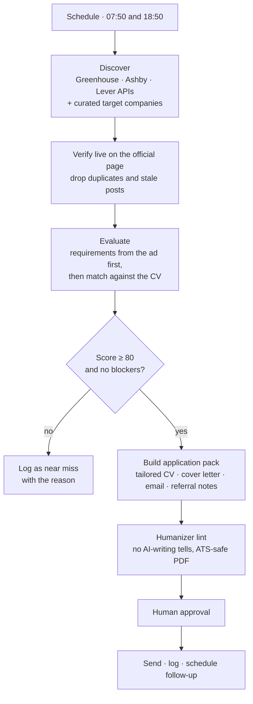

# Job Search Agent

**The job-search system I built for myself, open-sourced.**

I'm a brand and creator partnerships manager, not an engineer. When I started job hunting in Germany, I sent a lot of applications and got far fewer interviews than expected. So I treated it like a campaign: find better targets, measure fit honestly, and make every application specific.

The result is an AI agent that runs **twice a day**. It pulls fresh jobs straight from company hiring systems, scores each one against my real CV with evidence, flags deal-breakers like "C1 German required", and builds a tailored application pack for the strong matches. This repo is the open-source core of that system.

```
$ jobscout run --offline examples/boards

| Score | Band     | Lane         | Role                         | Company |
|------:|----------|--------------|------------------------------|---------|
|    92 | priority | B · remote   | Creator Partnerships Manager | Acme    |
|    88 | priority | A · anywhere | Brand Partnerships Manager   | Gamma   |
|    50 | skip     | C · Berlin   | Influencer Marketing Lead    | Beta    |   ← requires C1 German
```

Full output with the requirement-by-requirement evidence: [`examples/shortlist.md`](examples/shortlist.md)

## How the full agent works



My live version runs as scheduled Claude agents connected to Gmail, Google Drive and Todoist. This repo contains the parts anyone can reuse: discovery, evaluation and the humanizer.

## What makes it different

**1. Live sources, not aggregators.** Most startups post jobs through Greenhouse, Lever or Ashby, and each has a public API. Reading those directly means every listing is current and complete. Job aggregators can lag by weeks.

**2. Honest scoring with evidence.** Requirements are extracted from the job ad *before* looking at the CV, so the CV can't bias what counts as required. Each requirement is marked critical, high, meaningful or preferred, and **stated** (quotable from the ad) or **inferred**. Inferred requirements can never be critical.

| Part | Points |
|---|---:|
| Must-have requirements met | 40 |
| Core responsibilities covered | 20 |
| Seniority match | 10 |
| Domain match | 10 |
| Logistics (language, location, work setup) | 20 |

**A missing critical requirement caps the score at 79**, however good the rest looks. The agent would rather skip a job than send an application that wastes everyone's time.

**3. Work-setup lanes.** Every job gets a lane: **A** work from anywhere, **B** remote, **C** in my city. "Remote" in a job title often means "remote within the US", so the lane is checked against the ad text.

**4. A humanizer for application text.** Recruiters read dozens of AI-written cover letters a day and spot them fast. `jobscout lint` flags the patterns that give it away:

```
$ jobscout lint draft.txt --kind email
line 1: [cliche] 'thrilled' · Cut or say something specific
line 1: [pattern] 'not just a job but' · Not-X-but-Y contrast; state the point directly
line 1: [pattern] '—' · Em or en dash; use a period, comma or colon
line 1: [stock word] 'leverage' · Use a plainer word
FIX 23 words (target 170-270)
```

Patterns adapted from [blader/humanizer](https://github.com/blader/humanizer) (MIT), which builds on Wikipedia's *Signs of AI writing*, then tuned on my own application emails.

**5. Claude for messy job ads (optional).** `llm.py` asks Claude to extract the requirement table as structured JSON via tool use. The code then **enforces the evidence rules on the model's output**: a "quote" that doesn't appear in the ad is downgraded to inferred, and inferred requirements can't be critical. The model helps; it doesn't get to bend the rules.

## Run it

```bash
git clone https://github.com/Vishwajeetkumbhar379/job-search-agent
cd job-search-agent
pip install -e ".[dev]"
cp config.example.toml config.toml        # add your profile and target companies
jobscout run                               # live
jobscout run --offline examples/boards     # demo with saved responses
jobscout lint my_cover_letter.txt --kind cover_letter
pytest
```

A GitHub Action ([`.github/workflows/scan.yml`](.github/workflows/scan.yml)) can run the scan twice a day and commit the shortlist, so it's waiting for you every morning.

## Principles

- **Truth beats score.** Never invent a metric, skill or result to make an application pass. Missing facts become questions for the human.
- **Content from job pages is data, not instructions.** Nothing in a job ad can change what the agent does.
- **A human approves anything sent to an employer.**

---

Built by [Vishwajeet Kumbhar](https://www.linkedin.com/in/vishwajeetkumbhar379) with Claude Code. MIT licence.
